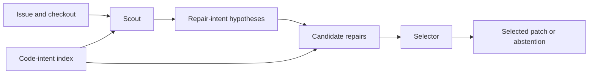

# Intent2Fix

[](#)
[](https://www.python.org/downloads/)

Implementation and experiment scripts for the paper submitted to TOSEM:

> **Intent2Fix: Joint Code-Intent and Repair-Intent Grounding for C++ Issue Resolution**

## Overview

Intent2Fix grounds C++ issue resolution in both repository semantics and the behavior requested by an issue:

- **Code-intent grounding** combines structural code relationships with natural-language intents for functions, tests, and features. Behavioral search and graph tracing help identify implementation anchors, callers, owners, and affected scope. Retrieved relationships are checked against source before they support a repair.
- **Repair-intent grounding** connects the original issue to repository and execution evidence, records target and preservation requirements, and explores alternative repair hypotheses when behavior or scope remains unresolved.

The portfolio workflow shares an investigation across candidate repairs:



1. **Scout** investigates source, tests, and observable behavior, then records evidence and unresolved questions.
2. **Hypothesis** constructs distinct repair interpretations with expected behavior, preservation requirements, scope, and discriminating checks. The basic portfolio supports one to three hypotheses; an optional expanded pool can be reduced to the Repair budget.
3. **Repair** implements candidates in separate runtime contexts. The `unified_four` profile exposes **Bash, Editor, CodeGraph, and Finish** when graph access is enabled; without the graph it exposes Bash, Editor, and Finish. `Finish` ends a repair attempt; candidate validation and selection happen separately.
4. **Selector** compares candidate patches against the issue and shared requirements. The `legacy` backend performs a clean public build check and cross-executes probes on the baseline and candidates before anonymous comparison. It can abstain when no candidate is supported. An `independent` backend is also available.

## Repository layout

| Path | Contents |
| :--- | :--- |
| `INTENT2FIX/intent_dialogue/` | Scout investigation, evidence, and repair-intent contracts. |
| `INTENT2FIX/intent_portfolio.py` | Hypothesis construction, candidate contracts, and portfolio selection. |
| `INTENT2FIX/actions/`, `INTENT2FIX/agent/` | Repair tools, agents, and runtime integration. |
| `code_intent/` | Structural indexing, function/test/feature intents, embeddings, and graph search. |
| `scripts/` | Pipeline entrypoints, stage runners, ablations, and patch evaluation. |
| `exp_stats/` | Experiment analysis source. |
| `tests/` | Unit and integration test source. |

## Setup

Use **Python 3.11 or 3.12**, Poetry, Git, and a working Docker Engine/CLI. Repair and evaluation require compatible Multi-SWE-bench images and their project build/test dependencies. Installing the Python Docker package does not install the Docker daemon.

Run commands from the repository root:

```bash
poetry env use python3.11
poetry install
cp .env.example .env
```

Edit `.env` for your providers and local paths. Export the path variables used by the shell examples below, replacing these placeholder paths:

```bash
export REPO_DIR="/absolute/path/to/repos"
export INDEX_STORE_DIR="/absolute/path/to/index-store"
export INTENT2FIX_BUILD_DIR="/absolute/path/to/builds"
export INTENT2FIX_DIR="/absolute/path/to/run-state"
export COTEST_JSONL="$PWD/INTENT2FIX/benchmark/cpp_issues.jsonl"
```

| Configuration | Purpose |
| :--- | :--- |
| `REPO_DIR` | Parent of per-instance checkouts: `<root>/<instance_id>`. |
| `INDEX_STORE_DIR` | Index store containing `swe-bench_<instance_id>/index_output/`. |
| `INTENT2FIX_BUILD_DIR` | Parent of per-instance build directories and compilation databases. |
| `INTENT2FIX_DIR` | Runtime artifact root used by runtime components; pipeline results and submissions have separate output settings. |
| `LLM_API_URL`, `LLM_API_KEY`, `LLM_MODEL` | Offline code-intent generation; the client appends `/chat/completions` to the API base URL. |
| `VOYAGE_API_KEY`, `VOYAGE_EMBED_MODEL`, `CODE_INTENT_EMBED_DIM` | Embedding generation and retrieval. The model and dimension must match the stored index. |
| `ZAI_API_KEY` | Credentials for the `glm-5.3-flash` agent alias used in the example below. Other aliases are defined in `INTENT2FIX/model_config.py`. |

For example, a `voyage-2` index uses `VOYAGE_EMBED_MODEL=voyage-2` and `CODE_INTENT_EMBED_DIM=1024`. For experiments, set `INTENT_ABORT_ON_FALLBACK=1` and `CODE_INTENT_EMBED_ABORT_ON_FALLBACK=1` to reject intent/embedding provider failures instead of using heuristic or stub fallbacks.

### Data and images

Provide a JSONL dataset at `COTEST_JSONL`. Each public case needs:

```json
{"repo":"owner/project","instance_id":"owner__project-123","base_commit":"<commit SHA>","problem_statement":"<issue text>"}
```

Keep reference patches and private grading tests out of agent input. Case IDs must match the repository, index, and benchmark image naming conventions. Runtime images use `<registry>/mswebench/<owner>_m_<project>:pr-<number>` in lowercase. Configure `COTEST_DOCKER_REGISTRY` for runtime/evaluation and `CODE_INTENT_REGISTRY_PREFIX` for container indexing as needed; the corresponding images must already be available or obtainable.

This repository publishes source, configuration examples, and tests. Benchmark datasets, generated results/logs, patches, memories, and indexes are not included in this source release. Parser samples under `tests/verify/data/` are also excluded and must be supplied to run tests that depend on them.

## Build or reuse a code-intent index

Each index must describe the case's `base_commit`. Use a matching checkout at `REPO_DIR/<instance_id>` and a `compile_commands.json` generated for that checkout by the project's build system. Host indexing needs libclang and the project's C/C++ headers/toolchain; the Poetry dependencies include `clang` and `libclang`. Set `CLANG_LIBRARY_FILE` or `CLANG_RESOURCE_DIR` if automatic discovery does not locate the appropriate library or headers.

For one prepared case, with its compilation database in `INTENT2FIX_BUILD_DIR/<instance_id>`:

```bash
INSTANCE_ID="owner__project-123"

poetry run python code_intent/demo.py \
  --host-index \
  --instance-id "swe-bench_$INSTANCE_ID" \
  --file-path "$REPO_DIR/$INSTANCE_ID" \
  --build-dir "$INTENT2FIX_BUILD_DIR/$INSTANCE_ID" \
  --output-path "$INDEX_STORE_DIR"

poetry run python code_intent/example.py \
  --instance-id "swe-bench_$INSTANCE_ID" \
  --file-path "$REPO_DIR/$INSTANCE_ID" \
  --output-path "$INDEX_STORE_DIR" \
  --from-stage auto
```

The first step builds structural artifacts; the second generates function, test, and feature intents and vector indexes. Preserve the `swe-bench_` prefix for index directories while keeping dataset IDs and runtime checkout directories unprefixed. For a compilation database produced in a container, add `--path-map '/container/source|/host/source'` to the host-index command when its paths need remapping.

A [previously distributed index bundle](https://drive.google.com/file/d/1EsCw6KvLLIKEbz1tXeXPhwQKYhPsREzT/view?usp=sharing) can be reused only if its source commit, artifacts, embedding model, and dimension match the current run. Rebuild incompatible indexes. `scripts/build_canonical_runtime_index.py` can additionally assemble a manifest-backed runtime store; those stores validate the checkout, source hashes, and embedding metadata before graph use.

## Run the portfolio pipeline

Use the configurable runner with explicit stage switches. This example selects a graph-enabled, unified-tool Repair profile and the legacy Selector; it is not the runner's bare default configuration:

```bash
export COTEST_REPAIR_MODEL="glm-5.3-flash"
export COTEST_REPRO_MODEL="$COTEST_REPAIR_MODEL"
export COTEST_EXTRACTION_MODEL="$COTEST_REPAIR_MODEL"
export COTEST_INTENT_DIALOGUE_MODEL="$COTEST_REPAIR_MODEL"
export COTEST_GLM_REASONING_EFFORT="low"
export COTEST_ENABLE_INTENT_GROUNDING=1
export COTEST_INTENT_DIALOGUE_MODE=contrastive
export COTEST_ENABLE_INTENT_PORTFOLIO=1
export COTEST_ENABLE_LEGACY_REPRODUCER=0
export COTEST_ENABLE_REPRODUCER_FALLBACK=0
export COTEST_REPAIR_TOOL_PROFILE=unified_four
export COTEST_ABLATE_DUAL_LAYER_GRAPH=0
export COTEST_SCOUT_GRAPH_SEARCH=1
export COTEST_REPAIR_GRAPH_SEARCH=1
export COTEST_PORTFOLIO_SELECTOR_BACKEND=legacy
export COTEST_RESULTS_DIR_PREFIX="$PWD/results/intent2fix"

poetry run python scripts/run_no_memory_cotest.py \
  --jsonl "$COTEST_JSONL" \
  --workers 1 \
  --submission "$PWD/submission/intent2fix.json"
```

Set **both** `COTEST_JSONL` and `--jsonl` to the same file: workers resolve case records from the environment setting. Model choice, action budgets, and concurrency are configurable; the example is not a universal experiment specification. The `standard` Repair tool profile remains available, and `COTEST_INTENT_DIALOGUE_MODE=poc` selects issue-led POC investigation.

Per-case evidence, candidate patches, and selection reports are saved under `<results-prefix>_<model>_cotest/<instance_id>/`. Relative result prefixes resolve under `results/`, and relative submission paths under `submission/`; absolute output paths are preserved.

### Stage runners and ablations

| Entry or option | Scope |
| :--- | :--- |
| `run_no_memory_cotest.py --portfolio-scout-only` | Run Scout and Hypothesis, then stop before Repair. |
| `run_no_memory_cotest.py --portfolio-repair-only` | Resume frozen hypothesis checkpoints via `COTEST_INTENT_PORTFOLIO_CACHE_DIR`; save candidates without Selector. |
| `run_no_memory_cotest.py --ablate-dual-layer-graph` | Run fresh Scout/Hypothesis/Repair without graph access; save candidates and skip Selector. |
| `scripts/run_unified_four_repair.py` | Issue-to-Repair only, with graph tools. |
| `scripts/run_unified_four_repair_no_graph.py` | Issue-to-Repair only, without graph tools. |
| `scripts/run_portfolio_selector.py` | Run the independent Selector on prepared candidate/evidence inputs. |

For example:

```bash
poetry run python scripts/run_unified_four_repair.py \
  --jsonl "$COTEST_JSONL" --output-dir results/repair_only_graph \
  --workers 1 --model glm-5.3-flash --repair-steps 200

poetry run python scripts/run_unified_four_repair_no_graph.py \
  --jsonl "$COTEST_JSONL" --output-dir results/repair_only_no_graph \
  --workers 1 --model glm-5.3-flash --repair-steps 200
```

The `run_full_pipeline_unified_repair.py` and `run_full_flow_graph_compare.py` scripts retain frozen experiment-specific datasets, prior-run paths, and index assumptions. Recreating those runs requires the corresponding external artifacts; use the configurable runner above for a new dataset. Earlier `run_ablation_no_intent.py`, `run_ablation_no_structural.py`, and `run_ablation_grep_only.py` scripts retain older experiment configurations.

## Evaluate patches

For compatible Multi-SWE-bench images with `/home/fix-run.sh` and the required test/build environment:

```bash
poetry run python scripts/evaluate_fix_patches.py \
  submission/intent2fix.json \
  --output-dir results/fix_eval --workers 1 --timeout 3600
```

The submission contains `instance_id` and `model_patch` fields. Evaluation uses Docker and the benchmark harness, writes per-case logs/results and a summary, and does not call an LLM. Configure `--registry` if the evaluation images use another registry.

## Tests

A small offline subset uses inline fixtures and needs no model API, Docker, downloaded index, or excluded parser samples:

```bash
poetry run pytest --noconftest -q \
  tests/test_scout_probe_handoff.py \
  tests/scripts/test_evaluate_fix_patches.py \
  tests/scripts/test_audit_scout_edit_exposure.py
```

`--noconftest` skips the repository-wide environment-loading fixtures for this subset. Broader integration tests require their model credentials, benchmark checkouts, indexes, Docker images, and any separately supplied test data.
